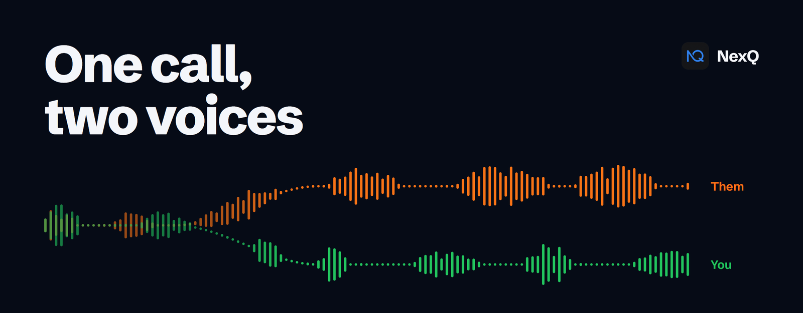
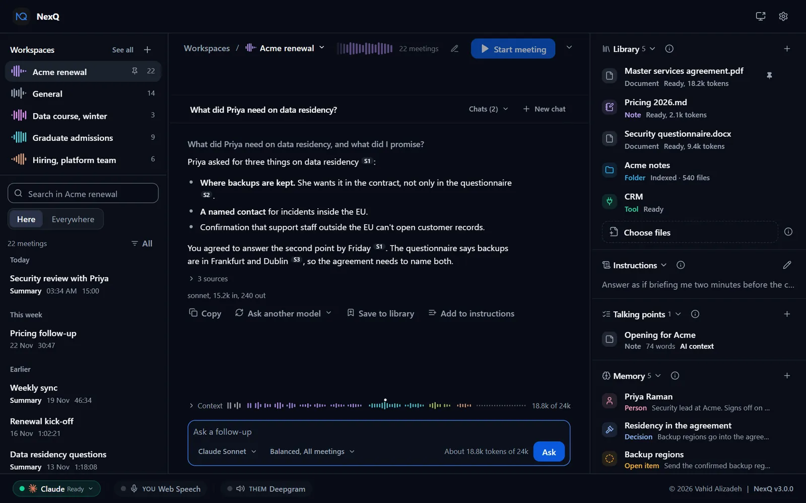
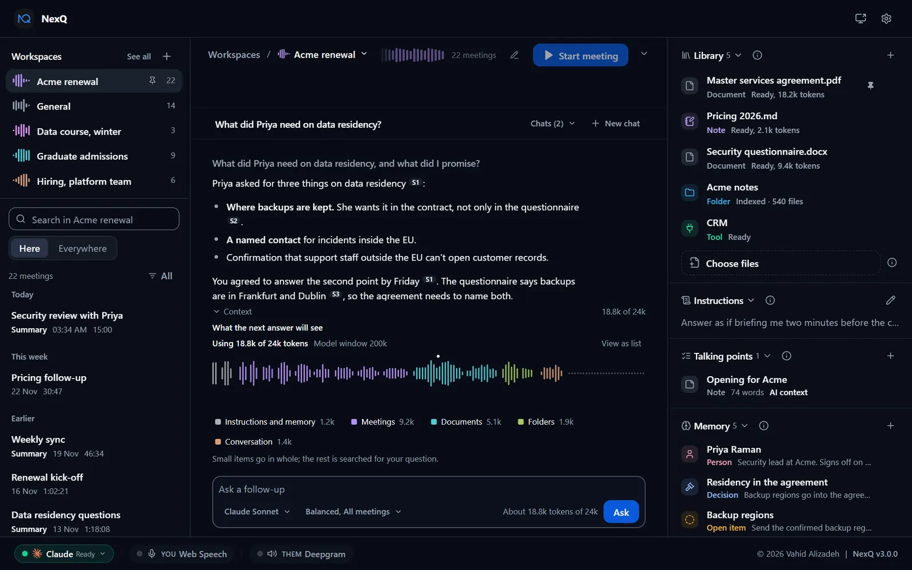
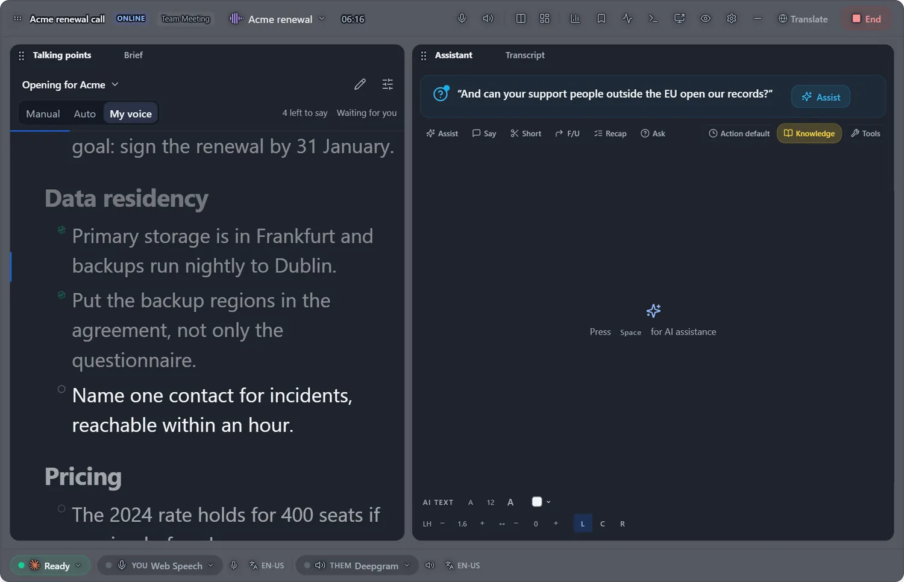
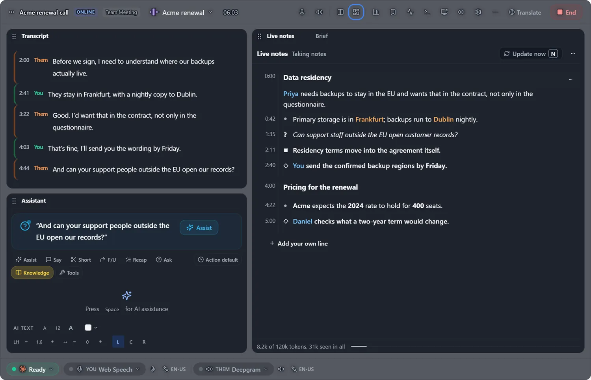
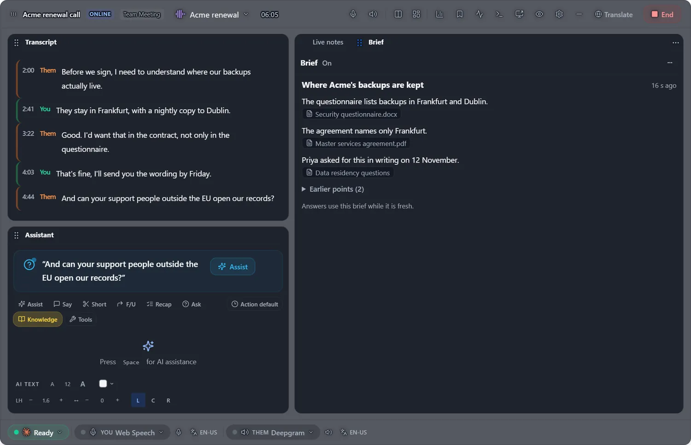
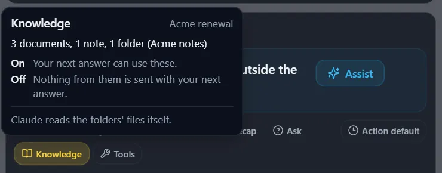
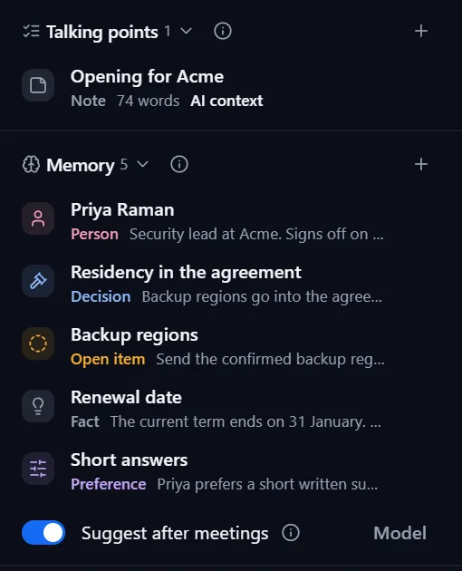
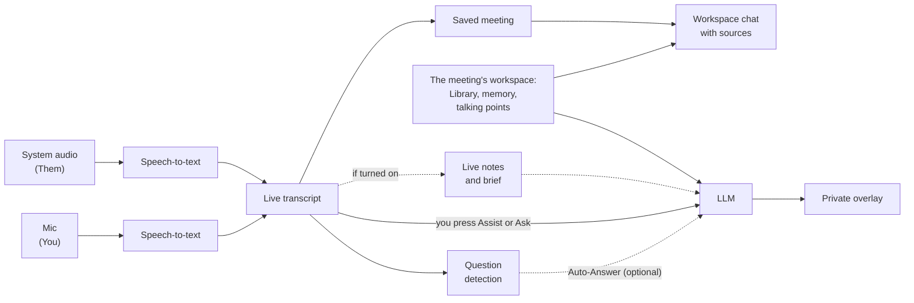
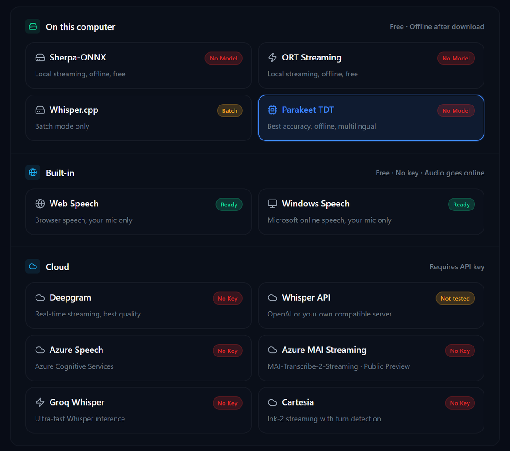

<div align="center">

<a href="https://getnexq.com/">
  
</a>

# NexQ

**Free, open-source AI meeting assistant, with a workspace for every client, class and project.**
It transcribes both sides of a call live and answers from your own notes, with local models or the AI you already use. No bot joins.

[](https://github.com/naxhq/NexQ/releases/latest)
[](https://github.com/naxhq/NexQ/releases)
[](https://github.com/naxhq/NexQ/actions/workflows/ci.yml)
[](LICENSE)
[](https://github.com/naxhq/NexQ/releases/latest)
[](https://github.com/naxhq/NexQ/stargazers)

**[Website](https://getnexq.com/)** ·
**[Download](https://github.com/naxhq/NexQ/releases/latest)** ·
**[Docs](docs/user-guide/getting-started.md)** ·
**[Guides](https://getnexq.com/guides/)** ·
**[Changelog](CHANGELOG.md)** ·
**[Report a bug](https://github.com/naxhq/NexQ/issues/new?template=bug_report.yml)**

<br>

<a href="https://getnexq.com/">
  
</a>

<sub>A workspace in NexQ 3.0 with invented demo data. <a href="https://getnexq.com/">Try the interactive demo</a> on the website.</sub>

</div>

---

<details>
<summary><b>Table of contents</b></summary>

- [Why NexQ](#why-nexq)
- [What's new in 3.0](#whats-new-in-30)
- [Quick start](#quick-start)
- [Features](#features)
- [See it](#see-it)
- [How it works](#how-it-works)
- [Providers](#providers)
- [Privacy](#privacy)
- [Use it responsibly](#use-it-responsibly)
- [How NexQ compares](#how-nexq-compares)
- [Keyboard shortcuts](#keyboard-shortcuts)
- [Development](#development)
- [Contributing](#contributing)
- [Community and support](#community-and-support)

</details>

## Why NexQ

- **Two sides, one transcript.** Your mic ("You") and the call audio ("Them") are separate streams. Each has its own speech engine, language and mute, so answers know who said what.
- **Answers in the moment.** Questions are caught as they are asked. Press one key, or turn on Auto-Answer, and the answer streams in, grounded in your notes, slides or other files.
- **A workspace for each piece of work.** Keep a client's meetings, files, notes and memory together and apart from everything else. Ask across all of it afterwards, with sources.
- **Yours to run.** Free, MIT licensed, no account and no usage caps. No bot joins your call. Use fully offline engines or the cloud providers you pick.
- **Bring your own models.** 12 speech-to-text engines and 10 LLM providers, including your existing Claude or ChatGPT subscription.
- **Private notes while you present.** Hide from screen share (off by default) leaves the overlay out of screen shares and recordings, and off the taskbar or Dock. See [Use it responsibly](#use-it-responsibly).

## What's new in 3.0

Version 3.0 is the biggest change so far. NexQ now opens on your **workspaces**.

- **Workspaces.** One for each client, class or project, with its own meetings, chats, Library of files, folders and tools, instructions, memory and talking points. Nothing leaks between workspaces, and **Keep separate** locks one off completely. Your existing meetings and files move into **General**. [Guide](docs/user-guide/workspaces.md)
- **Workspace chat.** Ask across a workspace's meetings, documents and folders. Every answer cites its sources and opens the meeting at the moment it came from. A context view shows what is sent and what is searched, and Lean, Balanced and Deep set how much material goes in. [Guide](docs/user-guide/workspace-chat.md)
- **Talking points.** Notes you read during a call. They can scroll with you, follow what you say (**My voice**), tick off what you have said and jump to the point you are on. [Guide](docs/user-guide/talking-points.md)
- **Live notes and the brief.** Notes written while you talk, and a short sheet of what the workspace already knows about the topic. Both are off until you turn them on. The brief goes into your live answers. [Guide](docs/user-guide/live-notes-and-brief.md)
- **Memory.** People, decisions, open items, facts and preferences, suggested after a meeting and saved only when you say so, each with a link back to the moment. [Guide](docs/user-guide/memory.md)
- **Knowledge and Tools pills** in the meeting assistant, scoped to the meeting's workspace. Folders you add are indexed and kept up to date on their own. Tools that could change something ask before they run. [Guide](docs/user-guide/library.md)
- **A meeting window you arrange.** Drag panels by their grips, save layouts, and have the windows remember where they were for each set of monitors. The overlay stays readable when you make it see-through, and the light theme got a contrast pass. [Guide](docs/user-guide/meeting-layout.md)

**Upgrading.** NexQ upgrades your database on the first start and keeps a copy of the old one for 14 days. Your Personal Sources folders and servers stay. The full list is in the [CHANGELOG](CHANGELOG.md).

Earlier releases:

- **v2.44 Codex.** Use your ChatGPT plan like Claude, with Fast and Deep models, live model lists and personal sources. Beta.
- **v2.41 Personal sources.** Let Claude look things up in your notes folders and MCP servers while it answers. Claude subscription only.
- **v2.40 Thinking control.** Choose how much each provider's model thinks.
- **v2.38 and v2.39 Language per side.** Transcribe each side in its own language, switch it from the overlay without ending the meeting, or let NexQ detect it.

## Quick start

**Windows 10 / 11**

1. Download `NexQ_<version>_x64-setup.exe` from the [latest release](https://github.com/naxhq/NexQ/releases/latest) and run it. It installs for your user only, no admin rights needed.
2. The installer is not code-signed, so SmartScreen may warn. Click **More info → Run anyway**, or [build from source](#development).

**macOS (Apple Silicon, beta)**

1. Download the `.dmg` from the [releases page](https://github.com/naxhq/NexQ/releases) and drag NexQ into Applications.
2. The beta build is not notarized, so Gatekeeper blocks it. Clear the flag once: `xattr -cr /Applications/NexQ.app`
3. Allow microphone and system-audio recording access when asked. System audio needs macOS 14.2 or later. Found a problem? [Open a bug report](https://github.com/naxhq/NexQ/issues/new?template=bug_report.yml) and pick macOS.

**Your first meeting**

The first launch opens a short setup. You can skip it; everything below is also in Settings.

1. **Set up speech-to-text.** In Settings → STT Providers, download the Parakeet model (local, free) or add a Deepgram or Groq key. Then in Settings → Audio & Devices, choose an engine for each side. A fresh install starts with cloud engines: Web Speech for your mic (no key) and Deepgram for the other side (needs a key). To keep audio on your computer, pick the **Local Only (Parakeet)** or **Fully Offline** preset. The **Free** preset needs no key, but your mic still goes through Web Speech.
2. **Pick an LLM** in Settings → LLM Providers. [Ollama](https://ollama.com) is found automatically, cloud providers need a key, and Claude or Codex can use your subscription.
3. **Optional:** you start with one workspace, **General**. Add your resume, notes or a folder of notes in its **Library**, or make a workspace for a client or a course with **+** next to **Workspaces**.
4. **Press** <kbd>Ctrl</kbd>+<kbd>M</kbd>. It starts a meeting in your default workspace, and **Start meeting** in the launcher lets you pick the workspace first. NexQ captures system audio, so it works with Zoom, Teams, Meet, Discord or anything that plays sound.
5. **Get an answer.** When a question comes up, press <kbd>Space</kbd> in the overlay, or <kbd>Ctrl</kbd>+<kbd>Shift</kbd>+<kbd>Space</kbd> from any app.

NexQ updates itself in the background and installs when you quit, never in the middle of a meeting. Updates are signed (Ed25519).

Guides: [Getting started](docs/user-guide/getting-started.md) · [Workspaces](docs/user-guide/workspaces.md) · [Workspace chat](docs/user-guide/workspace-chat.md) · [Talking points](docs/user-guide/talking-points.md) · [Live notes and the brief](docs/user-guide/live-notes-and-brief.md) · [Memory](docs/user-guide/memory.md) · [The Library](docs/user-guide/library.md) · [Meeting window layout](docs/user-guide/meeting-layout.md) · [Choosing providers](docs/user-guide/ai-providers.md) · [Audio setup](docs/user-guide/audio-setup.md) · [Interview copilot](docs/user-guide/interview-copilot.md) · [Lecture assistant](docs/user-guide/lecture-assistant.md) · [Meeting detection](docs/user-guide/meeting-detection.md) · [Claude subscription](docs/user-guide/claude-subscription.md) · [Troubleshooting](docs/user-guide/troubleshooting.md)

How-to: [Transcribe both sides of a call](https://getnexq.com/guides/transcribe-both-sides-of-a-call/) · [Local transcription on Windows](https://getnexq.com/guides/local-call-transcription-windows/) · [Transcribe calls on a Mac](https://getnexq.com/guides/transcribe-calls-on-a-mac/) · [Ollama or LM Studio in a call](https://getnexq.com/guides/ollama-lm-studio-meeting-assistant/) · [Your own Whisper server](https://getnexq.com/guides/own-whisper-server/) · [Translate a call live](https://getnexq.com/guides/live-call-translation/) · [NexQ next to Meetily, anarlog, Otter and Granola](https://getnexq.com/guides/open-source-otter-granola-alternative/)

## Features

### In the meeting

- **Both sides, apart.** Your mic and the system audio, each with its own engine, language and mute, with speaker labels, remote-speaker separation and echo cancellation.
- **One key answers.** Assist, What to Say, Shorten, Follow-Up, Recap and free-form Ask. Question detection catches what was asked, with optional Auto-Answer. Scenarios for interviews, lectures, oral exam practice, webinars and team meetings, with editable prompts.
- **Knowledge and Tools pills.** Decide per answer whether it may use the meeting's workspace files and tools. Ask about your screen with a screenshot (Claude subscription).
- **Talking points that follow you.** Manual, Auto-scroll or **My voice**, which follows what you say on your own PC. Lines you have said are ticked off, and **Go to** offers the point you seem to be on.
- **Live notes and the brief.** A tidy page of topics, decisions, tasks and questions as you talk, and a short sheet of what the workspace knows about the topic that your answers can use.
- **Live translation** with 5 providers: Microsoft and Google cover 100+ languages, OPUS-MT runs offline.
- **A window you arrange.** Dockable panels with drag grips, saved layouts, and a see-through overlay that stays readable.

### Workspaces

- **One per client, class or project**, each with its own meetings, chats, Library, instructions, memory and talking points. General holds everything from before 3.0.
- **Strict isolation.** A meeting or chat only reads its own workspace, plus General or workspaces you chose to also use. **Keep separate** shuts a workspace off both ways.
- **Workspace chat** across meetings, documents and folders, with `[S1]` citations that open the meeting at the right moment, a context view of what each answer saw, Lean, Balanced and Deep budgets that follow the model's window, and tool approval (**Allow once** or **Deny**).
- **A Library** of documents, notes, folders and tools. Folders are indexed and kept up to date by a file watcher. Local RAG over PDF, DOCX, TXT and MD files (SQLite FTS plus embeddings) still serves live answers.
- **Memory**: people, decisions, open items, facts and preferences you approved.

### After the meeting

- Recording with synced transcript playback, searchable history, and "Ask a past meeting" with the same Knowledge and Tools pills.
- Summaries, action items, bookmarks and topic sections, and the live notes you took, editable and exportable as Markdown.
- Memory suggestions from the transcript, each linked to the moment it came from.
- Search across one workspace or all of them.

### Your AI

- 12 speech-to-text engines, 10 LLM providers and 5 translation providers. Run everything on your PC, or use your own keys.
- Use your **Claude** or **ChatGPT (Codex)** subscription with no API key (beta), including personal sources: notes folders and MCP servers.
- Thinking control per provider, and an AI Call Log with every prompt, latency and token count.

### Privacy

- No bot, no account, no telemetry. See [Privacy](#privacy) for exactly what leaves your PC.
- Keys in the OS credential store. Meetings, transcripts, recordings and indexes in a local database on your disk.
- Hide from screen share, off by default.

## See it

<table>
<tr>
<td width="50%" valign="top">

<sub><b>Workspace chat.</b> Ask across a workspace. The context view shows what the next answer will see.</sub>
</td>
<td width="50%" valign="top">

<sub><b>Talking points in My voice mode.</b> The note follows what you say and ticks off what you have covered.</sub>
</td>
</tr>
<tr>
<td valign="top">

<sub><b>Live notes.</b> Topics, decisions, tasks and questions, written while you talk.</sub>
</td>
<td valign="top">

<sub><b>The brief.</b> What the workspace already knows about the topic, with sources.</sub>
</td>
</tr>
<tr>
<td valign="top">

<sub><b>Knowledge and Tools.</b> Hover a pill to see what the next answer may use.</sub>
</td>
<td valign="top">

<sub><b>Memory.</b> Facts the workspace keeps, each saved by you.</sub>
</td>
</tr>
</table>

<sub>All screenshots show invented demo data.</sub>

<div align="center">
  <a href="https://getnexq.com/#demo">
    
  </a>
  <br>
  <sub>A lecture in demo mode: live transcript on the left, a recap on the right.</sub>
</div>

## How it works



Audio is captured on your machine. What leaves it depends on the engines you pick: with a local speech engine and a local LLM, nothing does. Searching your files and meetings for the workspace chat and the brief happens on your PC too, and only what an answer uses goes to the model you chose.

## Providers

| | Runs on your device | Cloud |
|---|---|---|
| **Speech-to-text (12)** | Parakeet TDT, Sherpa-ONNX, ORT Streaming, Whisper.cpp (recordings only, not live calls) | Deepgram, Groq Whisper, Whisper API, Azure Speech, Azure MAI Streaming (public preview), Cartesia, Web Speech (no key, mic only), Windows Speech (no key, Windows, mic only) |
| **LLM (10)** | Ollama, LM Studio | OpenAI, Anthropic, Google Gemini, Groq, OpenRouter, any custom endpoint, and, with no API key (beta): Claude through your Pro or Max plan (Claude Code CLI), Codex through your ChatGPT plan |
| **Translation (5)** | OPUS-MT (offline) | DeepL, Google, Microsoft, or any LLM you configured |

<div align="center">
  
  <br>
  <sub>The app says where each engine sends your audio.</sub>
</div>

Not every engine covers every language. [Choosing providers](docs/user-guide/ai-providers.md) lists what each one supports.

<details>
<summary><b>Folders and tools: the Knowledge and Tools pills</b></summary>

<br>

Let the AI look things up in your own notes and tools while it answers, for example "who is Dana and what is open with her?". Add them to a workspace's Library, or in Settings, Personal Sources.

- **Notes folders.** Add folders of `.md`, `.txt`, `.pdf` or `.docx` files, such as an Obsidian vault. NexQ reads them and keeps them up to date by itself, and never changes them. With a Claude, Codex or Antigravity subscription an answer can open the files itself. With an API or local provider, NexQ searches the folders on your PC and sends the best matching passages.
- **Tool servers (MCP).** Paste the `mcpServers` JSON from a server's README, fill in a form, or import from Claude Code. New servers start off and are checked right away. OAuth sign-in is not supported yet. Tools need a Claude, Codex or Antigravity subscription.
- **Permissions.** Each tool has its own switch, and tools that sound like they change something start off. In a workspace chat, a tool that could change something asks first: **Allow once** or **Deny**, with no "always allow".
- **You choose per answer.** In a meeting, the **Knowledge** and **Tools** pills decide whether an answer may use the workspace's files and tools. Knowledge starts on, Tools start off. Automatic answers never use your folders or tools.
- **Privacy.** Secret values are kept in the OS credential store. Passages and tool results go to your AI provider as part of the answer, so only add sources you are happy to share with it.

Details: [The Library](docs/user-guide/library.md) and the [Claude subscription guide](docs/user-guide/claude-subscription.md).

</details>

## Privacy

- **Nothing leaves your machine unless you use a cloud provider.** The defaults are: Web Speech for your mic and Deepgram for the other side. A local speech engine on both sides plus a local LLM works offline.
- **Your data stays on disk you control.** Meetings, transcripts, recordings, models, memory and the search indexes live in the app data folder (`%APPDATA%\com.nexq.app` on Windows, `~/Library/Application Support/com.nexq.app` on macOS).
- **Workspaces keep material apart.** A meeting or chat reads only its own workspace, plus General or workspaces you chose to also use. **Keep separate** makes a workspace unusable by any other. Other workspaces' meetings and chats are never included.
- **Searching happens on your PC.** Indexing your files and meetings for the workspace chat and the brief sends nothing anywhere. The one exception is **Prepare recaps with AI**, which is off by default and sends one meeting's transcript at a time to a model.
- **Live notes, the brief and memory suggestions** use the model you pick for them, so the transcript goes to that provider. With Ollama or LM Studio on your PC it stays there. Live notes and the brief are off until you turn them on.
- **Secrets go to the OS credential store.** Windows Credential Manager or the macOS Keychain.
- **No telemetry or analytics.** Besides the providers you configure and the models you download, NexQ only contacts GitHub, to check for signed updates and show release notes.
- **Hide from screen share** (<kbd>Ctrl</kbd>+<kbd>Shift</kbd>+<kbd>H</kbd>) works on Windows 10 version 2004 and later, and on macOS. On macOS 14 and later, some recorders that use ScreenCaptureKit can still capture NexQ, so run a test share first. It also hides NexQ from the taskbar (Windows) or the Dock and <kbd>Cmd</kbd>+<kbd>Tab</kbd> (macOS).
- **Claude screenshots** can contain other people's video or documents. They go to Anthropic with your question, and NexQ does not save them.
- Found a security issue? Follow [SECURITY.md](SECURITY.md).

## Use it responsibly

- **Tell people.** Let the others on the call know you are transcribing or recording, and get their consent where the law asks for it. Rules differ by place. Recording is off until you turn it on.
- **Check that it is allowed.** Some interviews, exams, classes and workplaces forbid AI help or transcription. If yours does, do not use NexQ there.
- **Know the limits of hiding.** Hide from screen share is off by default. It keeps private notes out of what you present. It does not make NexQ undetectable.

## How NexQ compares

| | NexQ | Otter.ai | Granola | Krisp |
|---|:---:|:---:|:---:|:---:|
| Price | **Free** | Free plan, paid tiers | Free plan, paid tiers | Free trial, paid tiers |
| Open source | Yes | No | No | No |
| Fully local option | Yes | No | No | Enterprise plan |
| Works without a bot | Yes | Desktop app | Yes | Yes |
| Choice of STT and LLM | Yes | Fixed | AI from a list | Fixed |
| Local LLM | Yes | No | No | No |
| Your own documents as context | Yes | Connectors | In chat | No |

<sub>Checked Nov 2026. Competitor cells reflect their public pages when we last checked and change over time. Check each vendor for current details.</sub>

## Keyboard shortcuts

On macOS, use <kbd>Cmd</kbd> in place of <kbd>Ctrl</kbd>. The three <kbd>Ctrl</kbd>+<kbd>Shift</kbd> shortcuts can be changed in Settings → General. In a meeting, with a NexQ window focused, <kbd>Space</kbd> runs Assist and <kbd>1</kbd> to <kbd>5</kbd> run the other actions ([full list](docs/user-guide/keyboard-shortcuts.md)). The in-meeting keys can be changed in Settings → Hotkeys.

| Shortcut | Action |
|---|---|
| <kbd>Ctrl</kbd>+<kbd>M</kbd> | Start or end a meeting |
| <kbd>Ctrl</kbd>+<kbd>B</kbd> | Switch between the overlay and the dashboard |
| <kbd>Ctrl</kbd>+<kbd>Shift</kbd>+<kbd>Space</kbd> | Assist from any app, without switching windows |
| <kbd>Ctrl</kbd>+<kbd>Shift</kbd>+<kbd>S</kbd> | Capture the screen into Ask (Claude subscription, Windows) |
| <kbd>Ctrl</kbd>+<kbd>Shift</kbd>+<kbd>H</kbd> | Hide from screen share |
| <kbd>Ctrl</kbd>+<kbd>,</kbd> | Open or close Settings |

In the launcher, <kbd>Ctrl</kbd>+<kbd>Shift</kbd>+<kbd>O</kbd> switches workspace, <kbd>Ctrl</kbd>+<kbd>Shift</kbd>+<kbd>N</kbd> creates one, and <kbd>Ctrl</kbd>+<kbd>Shift</kbd>+<kbd>Y</kbd> shows or hides the Library when the window is narrow. In the meeting window, <kbd>N</kbd> updates the live notes now.

## Development

NexQ is a [Tauri 2](https://v2.tauri.app/) app: a Rust backend and a React 18 + TypeScript frontend.

| | Windows | macOS (Apple Silicon) |
|---|---|---|
| Toolchain | [Node.js](https://nodejs.org/) 20+, [Rust](https://rustup.rs/) stable with the Visual Studio C++ build tools, [WebView2](https://developer.microsoft.com/microsoft-edge/webview2/) (ships with Windows 11) | Node.js 20+, Rust stable, Xcode Command Line Tools (`xcode-select --install`) |
| Native build tools | CMake, Ninja, LLVM: `winget install Kitware.CMake Ninja-build.Ninja LLVM.LLVM` | CMake: `brew install cmake` |

```bash
git clone https://github.com/naxhq/NexQ.git
cd NexQ
npm install
npx tauri dev          # run the full app with hot reload
```

On macOS, run `source scripts/macos-env.sh` in that shell first (`./build-mac.sh` does it for you).

| Task | Command |
|---|---|
| Frontend tests (Vitest) | `npm test` |
| Rust tests | `cargo test --lib` (in `src-tauri/`) |
| Type check | `npx tsc --noEmit` |
| Production frontend build | `npm run build` |
| Windows installer | `npx tauri build` |
| macOS app and dmg | `./build-mac.sh` |

Setup details, debugging and logs are in [docs/DEVELOPMENT.md](docs/DEVELOPMENT.md). How the pieces fit together is in [docs/ARCHITECTURE.md](docs/ARCHITECTURE.md).

## Contributing

Bug reports, docs, translations, new providers and macOS testing are all welcome. Start with [CONTRIBUTING.md](CONTRIBUTING.md) and look for [`good first issue`](https://github.com/naxhq/NexQ/labels/good%20first%20issue) and [`help wanted`](https://github.com/naxhq/NexQ/labels/help%20wanted). Please follow the [Code of Conduct](CODE_OF_CONDUCT.md). Ideas and priorities live in [feature requests](https://github.com/naxhq/NexQ/issues/new?template=feature_request.yml) and [Discussions](https://github.com/naxhq/NexQ/discussions).

## Community and support

- **Questions and ideas:** [GitHub Discussions](https://github.com/naxhq/NexQ/discussions)
- **Something broken:** check [Troubleshooting](docs/user-guide/troubleshooting.md), then open an [issue](https://github.com/naxhq/NexQ/issues/new/choose) with your log from **Settings → About → Diagnostics → Copy recent log** ([how](docs/user-guide/troubleshooting.md#collecting-logs-for-a-bug-report))
- **Security reports:** privately, via [SECURITY.md](SECURITY.md)
- More in [SUPPORT.md](SUPPORT.md)

## Contributors

<a href="https://github.com/naxhq/NexQ/graphs/contributors">
  
</a>

## Star history

If NexQ helps you, a star helps others find it.

<a href="https://star-history.com/#naxhq/NexQ&Date">
  <picture>
    <source media="(prefers-color-scheme: dark)" srcset="https://api.star-history.com/svg?repos=naxhq/NexQ&type=Date&theme=dark">
    
  </picture>
</a>

## License

[MIT](LICENSE). Copyright (c) 2026 Vahid Alizadeh.

<details>
<summary>Acknowledgements</summary>

<br>

NexQ stands on the shoulders of
[Tauri](https://tauri.app/),
[React](https://react.dev/),
[whisper.cpp](https://github.com/ggml-org/whisper.cpp) and [whisper-rs](https://github.com/tazz4843/whisper-rs),
[ONNX Runtime](https://onnxruntime.ai/) and the [`ort`](https://github.com/pykeio/ort) crate,
[sherpa-onnx](https://github.com/k2-fsa/sherpa-onnx),
[cpal](https://github.com/RustAudio/cpal),
[rusqlite](https://github.com/rusqlite/rusqlite),
[Zustand](https://github.com/pmndrs/zustand),
[Tailwind CSS](https://tailwindcss.com/) and [shadcn/ui](https://ui.shadcn.com/),
and [OPUS-MT](https://github.com/Helsinki-NLP/Opus-MT).
Thanks to every contributor, including [@visitek](https://github.com/visitek) for the macOS port.

</details>
