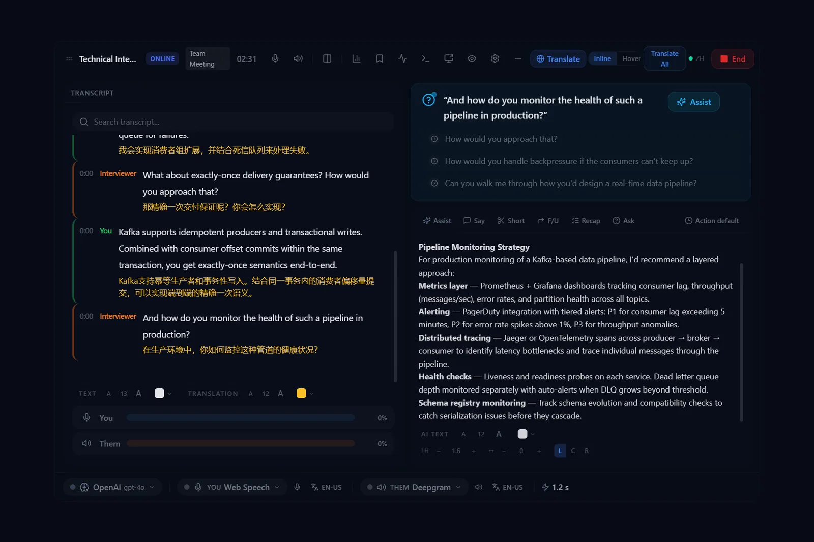
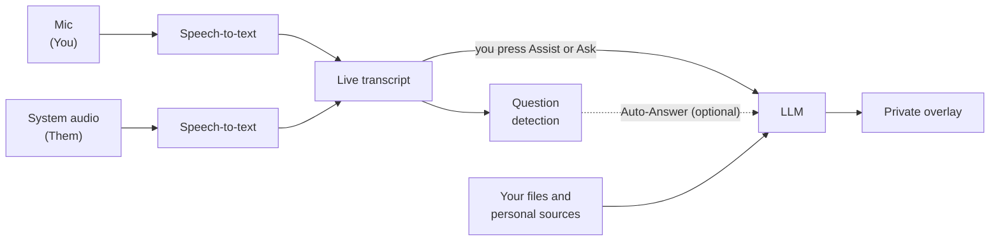

<div align="center">


# NexQ

**Free, open-source AI meeting assistant and interview copilot.**
It hears both sides of a call, answers on a private overlay, and can hide from your screen share.

[](https://github.com/naxhq/NexQ/releases/latest)
[](https://github.com/naxhq/NexQ/releases)
[](https://github.com/naxhq/NexQ/actions/workflows/ci.yml)
[](LICENSE)
[](https://github.com/naxhq/NexQ/releases/latest)
[](https://github.com/naxhq/NexQ/stargazers)

**[Website](https://naxhq.github.io/NexQ/)** ·
**[Download](https://github.com/naxhq/NexQ/releases/latest)** ·
**[Docs](docs/user-guide/getting-started.md)** ·
**[Changelog](CHANGELOG.md)** ·
**[Report a bug](https://github.com/naxhq/NexQ/issues/new?template=bug_report.yml)**

<br>

<a href="https://naxhq.github.io/NexQ/#demo">
  
</a>

<sub>Try the interactive overlay demo on the <a href="https://naxhq.github.io/NexQ/">website</a>.</sub>

</div>

---

## Why NexQ

- **Two sides, one transcript.** Your mic ("You") and the call audio ("Them") are separate streams. Each has its own speech engine, language and mute, so answers know who said what.
- **Answers in the moment.** Questions are caught as they are asked. Press one key, or turn on Auto-Answer, and the answer streams in, grounded in your resume, notes or slides.
- **Yours to run.** Free, MIT licensed, no account and no usage caps. No bot joins your call. Use fully offline engines or the cloud providers you pick.
- **Hidden from the share.** Turn on Hide from screen share and the overlay stays visible to you but is left out of screen shares and recordings, and off the taskbar or Dock.
- **Bring your own models.** 11 speech-to-text engines and 9 LLM providers, including your existing Claude subscription.

## Quick start

**Windows 10 / 11**

1. Download `NexQ_<version>_x64-setup.exe` from the [latest release](https://github.com/naxhq/NexQ/releases/latest) and run it. It installs for your user only, no admin rights needed.
2. The installer is not code-signed, so SmartScreen may warn. Click **More info → Run anyway**, or [build from source](#development).

**macOS (Apple Silicon, beta)**

1. Download the `.dmg` from the [releases page](https://github.com/naxhq/NexQ/releases) and drag NexQ into Applications.
2. The beta build is not notarized, so Gatekeeper blocks it. Clear the flag once: `xattr -cr /Applications/NexQ.app`
3. Allow microphone and system-audio recording access when asked. System audio needs macOS 14.2 or later. Found a problem? [Open a bug report](https://github.com/naxhq/NexQ/issues/new?template=bug_report.yml) and pick macOS.

**Your first meeting**

The first launch opens a short setup. You can skip it; everything below is also in Settings.

1. **Set up speech-to-text.** In Settings → STT Providers, download the Parakeet model (local, free) or add a Deepgram or Groq key. Then in Settings → Audio & Devices, choose an engine for each side, or pick the **Free** preset (Web Speech for your mic, Parakeet for the other side). Web Speech needs no key but sends your mic audio to a cloud service.
2. **Pick an LLM** in Settings → LLM Providers. [Ollama](https://ollama.com) is found automatically, cloud providers need a key, and Claude can use your subscription.
3. **Optional:** add your resume or notes under **Meeting Context** on the dashboard.
4. **Press** <kbd>Ctrl</kbd>+<kbd>M</kbd>. NexQ captures system audio, so it works with Zoom, Teams, Meet, Discord or anything that plays sound.
5. **Get an answer.** When a question comes up, press <kbd>Space</kbd> in the overlay, or <kbd>Ctrl</kbd>+<kbd>Shift</kbd>+<kbd>Space</kbd> from any app.

NexQ updates itself in the background and installs when you quit, never in the middle of a meeting. Updates are signed (Ed25519).

Guides: [Getting started](docs/user-guide/getting-started.md) · [Choosing providers](docs/user-guide/ai-providers.md) · [Audio setup](docs/user-guide/audio-setup.md) · [Interview copilot](docs/user-guide/interview-copilot.md) · [Lecture assistant](docs/user-guide/lecture-assistant.md) · [Meeting detection](docs/user-guide/meeting-detection.md) · [Claude subscription](docs/user-guide/claude-subscription.md) · [Troubleshooting](docs/user-guide/troubleshooting.md)

## What's new

- **v2.41 Personal sources.** Let Claude look things up in your notes folders and MCP servers while it answers. Claude subscription only.
- **v2.40 Thinking control.** Choose how much each provider's model thinks.
- **v2.38 and v2.39 Language per side.** Transcribe each side in its own language, switch it from the overlay without ending the meeting, or let NexQ detect it. Ukrainian was added.
- **v2.38 Screenshot into Ask.** <kbd>Ctrl</kbd>+<kbd>Shift</kbd>+<kbd>S</kbd> attaches your screen to a question (Windows, Claude subscription).

The full history is in the [CHANGELOG](CHANGELOG.md).

## Features

<table>
<tr>
<td valign="top" width="50%">

**Hear both sides**
- Your mic and system audio, each with its own engine, language and mute
- Speech engines picked per side, local or cloud
- Speaker labels and remote-speaker separation, echo cancellation
- Live translation with 5 providers: Microsoft and Google cover 100+ languages, OPUS-MT runs offline

</td>
<td valign="top" width="50%">

**Answer in the moment**
- Assist, What to Say, Shorten, Follow-Up, Recap and free-form Ask
- Question Detection, with optional Auto-Answer
- Scenarios for interviews, lectures, oral exams, webinars and team meetings, with editable prompts
- Ask about your screen with a screenshot (Claude subscription)

</td>
</tr>
<tr>
<td valign="top">

**Your context**
- Local RAG over your PDF, DOCX, TXT and MD files (SQLite FTS plus embeddings)
- Personal sources: notes folders and MCP servers (Claude subscription)
- Thinking control per provider
- AI Call Log: every prompt, latency and token count

</td>
<td valign="top">

**Around the meeting**
- Always-on-top transparent overlay with global shortcuts
- Call detection for Zoom, Teams, Meet and Webex (Windows)
- Bookmarks, action items, summaries and topic sections
- Recording with synced transcript playback, searchable history, "Ask a past meeting"

</td>
</tr>
</table>

## How it works



Audio is captured on your machine. What leaves it depends on the engines you pick: with a local speech engine and a local LLM, nothing does.

## Providers

| | Runs on your device | Cloud |
|---|---|---|
| **Speech-to-text (11)** | Parakeet TDT, Sherpa-ONNX, ORT Streaming, Windows Speech (Windows, mic only), Whisper.cpp (recordings only, not live calls) | Deepgram, Groq Whisper, Whisper API, Azure Speech, Cartesia, Web Speech (no key, mic only) |
| **LLM (9)** | Ollama, LM Studio | OpenAI, Anthropic, Google Gemini, Groq, OpenRouter, any custom endpoint, and Claude through your Pro or Max subscription (official Claude Code CLI, beta, no API key) |
| **Translation (5)** | OPUS-MT (offline) | DeepL, Google, Microsoft, or any LLM you configured |

Not every engine covers every language. [Choosing providers](docs/user-guide/ai-providers.md) lists what each one supports.

<details>
<summary><b>Personal sources (Claude subscription only)</b></summary>

<br>

Let Claude look things up in your own notes and tools while it answers, for example "who is Dana and what is open with her?".

- **Notes folders.** Add folders of `.md` files, such as an Obsidian vault. Claude can search and read them. It cannot change them, and nothing is copied or indexed.
- **Tool servers (MCP).** Paste the `mcpServers` JSON from a server's README, fill in a form, or import from Claude Code. New servers start off and are checked right away. OAuth sign-in is not supported yet.
- **Permissions.** Each tool has its own switch, and tools that sound like they change something start off.
- **You choose per answer.** The Notes and Tools pills decide whether an answer may use them. Automatic answers never use your sources.
- **Privacy.** Secret values are kept in the OS credential store. Notes and tool results go to Claude as part of the answer, so only add sources you are happy to share with it.

With any other provider your sources stay saved but are not used. Details: [Claude subscription guide](docs/user-guide/claude-subscription.md).

</details>

## Privacy

- **Nothing leaves your machine unless you use a cloud provider.** Web Speech, the default for your mic, is one. A local speech engine on both sides plus a local LLM works offline.
- **Your data stays on disk you control.** Meetings, transcripts, recordings, models and the RAG index live in the app data folder (`%APPDATA%\com.nexq.app` on Windows, `~/Library/Application Support/com.nexq.app` on macOS).
- **Secrets go to the OS credential store.** Windows Credential Manager or the macOS Keychain.
- **No telemetry or analytics.** Besides the providers you configure and the models you download, NexQ only contacts GitHub, to check for signed updates and show release notes.
- **Hide from screen share** (<kbd>Ctrl</kbd>+<kbd>Shift</kbd>+<kbd>H</kbd>) works on Windows 10 version 2004 and later, and on macOS. On macOS 14 and later, some recorders that use ScreenCaptureKit can still capture NexQ, so run a test share first. It also hides NexQ from the taskbar (Windows) or the Dock and <kbd>Cmd</kbd>+<kbd>Tab</kbd> (macOS).
- **Claude screenshots** can contain other people's video or documents. They go to Anthropic with your question, and NexQ does not save them.
- Found a security issue? Follow [SECURITY.md](SECURITY.md).

## How NexQ compares

| | NexQ | Otter.ai | Granola | Krisp |
|---|:---:|:---:|:---:|:---:|
| Price | **Free** | Free plan, paid tiers | Free plan, paid tiers | Free plan, paid tiers |
| Open source | Yes | No | No | No |
| Fully local option | Yes | No | No | Partial |
| No bot joins the call | Yes | No | Yes | Yes |
| Choice of STT and LLM | Yes | Fixed | Fixed | Fixed |
| Local LLM | Yes | No | No | No |
| Your own documents as context | Yes | No | No | No |

<sub>Checked Nov 2026. Competitor cells reflect their public pages when we last checked and change over time. Check each vendor for current details.</sub>

## Keyboard shortcuts

On macOS, use <kbd>Cmd</kbd> in place of <kbd>Ctrl</kbd>. The three <kbd>Ctrl</kbd>+<kbd>Shift</kbd> shortcuts can be changed in Settings → General. In a meeting, with a NexQ window focused, <kbd>Space</kbd> runs Assist and <kbd>1</kbd> to <kbd>5</kbd> run the other actions ([full list](docs/user-guide/keyboard-shortcuts.md)).

| Shortcut | Action |
|---|---|
| <kbd>Ctrl</kbd>+<kbd>M</kbd> | Start or end a meeting |
| <kbd>Ctrl</kbd>+<kbd>B</kbd> | Switch between the overlay and the dashboard |
| <kbd>Ctrl</kbd>+<kbd>Shift</kbd>+<kbd>Space</kbd> | Assist from any app, without switching windows |
| <kbd>Ctrl</kbd>+<kbd>Shift</kbd>+<kbd>S</kbd> | Capture the screen into Ask (Claude subscription, Windows) |
| <kbd>Ctrl</kbd>+<kbd>Shift</kbd>+<kbd>H</kbd> | Hide from screen share |
| <kbd>Ctrl</kbd>+<kbd>,</kbd> | Open or close Settings |

## Development

NexQ is a [Tauri 2](https://v2.tauri.app/) app: a Rust backend and a React 18 + TypeScript frontend.

| | Windows | macOS (Apple Silicon) |
|---|---|---|
| Toolchain | [Node.js](https://nodejs.org/) 20+, [Rust](https://rustup.rs/) stable with the Visual Studio C++ build tools, [WebView2](https://developer.microsoft.com/microsoft-edge/webview2/) (ships with Windows 11) | Node.js 20+, Rust stable, Xcode Command Line Tools (`xcode-select --install`) |
| Native build tools | CMake, Ninja, LLVM: `winget install Kitware.CMake Ninja-build.Ninja LLVM.LLVM` | CMake: `brew install cmake` |

```bash
git clone https://github.com/naxhq/NexQ.git
cd NexQ
npm install
npx tauri dev          # run the full app with hot reload
```

On macOS, run `source scripts/macos-env.sh` in that shell first (`./build-mac.sh` does it for you).

| Task | Command |
|---|---|
| Frontend tests (Vitest) | `npm test` |
| Rust tests | `cargo test --lib` (in `src-tauri/`) |
| Type check | `npx tsc --noEmit` |
| Production frontend build | `npm run build` |
| Windows installer | `npx tauri build` |
| macOS app and dmg | `./build-mac.sh` |

Setup details, debugging and logs are in [docs/DEVELOPMENT.md](docs/DEVELOPMENT.md). How the pieces fit together is in [docs/ARCHITECTURE.md](docs/ARCHITECTURE.md).

## Contributing

Bug reports, docs, translations, new providers and macOS testing are all welcome. Start with [CONTRIBUTING.md](CONTRIBUTING.md) and look for [`good first issue`](https://github.com/naxhq/NexQ/labels/good%20first%20issue) and [`help wanted`](https://github.com/naxhq/NexQ/labels/help%20wanted). Please follow the [Code of Conduct](CODE_OF_CONDUCT.md). Ideas and priorities live in [feature requests](https://github.com/naxhq/NexQ/issues/new?template=feature_request.yml) and [Discussions](https://github.com/naxhq/NexQ/discussions).

## Community and support

- **Questions and ideas:** [GitHub Discussions](https://github.com/naxhq/NexQ/discussions)
- **Something broken:** check [Troubleshooting](docs/user-guide/troubleshooting.md), then open an [issue](https://github.com/naxhq/NexQ/issues/new/choose) with your log from **Settings → About → Diagnostics → Copy recent log** ([how](docs/user-guide/troubleshooting.md#collecting-logs-for-a-bug-report))
- **Security reports:** privately, via [SECURITY.md](SECURITY.md)
- More in [SUPPORT.md](SUPPORT.md)

If NexQ helps you, a star helps others find it.

## License

[MIT](LICENSE). Copyright (c) 2026 Vahid Alizadeh.

<details>
<summary>Acknowledgements</summary>

<br>

NexQ stands on the shoulders of
[Tauri](https://tauri.app/),
[React](https://react.dev/),
[whisper.cpp](https://github.com/ggml-org/whisper.cpp) and [whisper-rs](https://github.com/tazz4843/whisper-rs),
[ONNX Runtime](https://onnxruntime.ai/) and the [`ort`](https://github.com/pykeio/ort) crate,
[sherpa-onnx](https://github.com/k2-fsa/sherpa-onnx),
[cpal](https://github.com/RustAudio/cpal),
[rusqlite](https://github.com/rusqlite/rusqlite),
[Zustand](https://github.com/pmndrs/zustand),
[Tailwind CSS](https://tailwindcss.com/) and [shadcn/ui](https://ui.shadcn.com/),
and [OPUS-MT](https://github.com/Helsinki-NLP/Opus-MT).
Thanks to every contributor, including [@visitek](https://github.com/visitek) for the macOS port.

</details>
