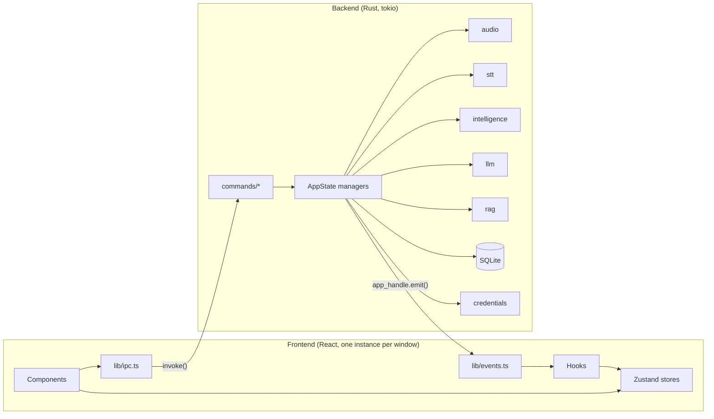
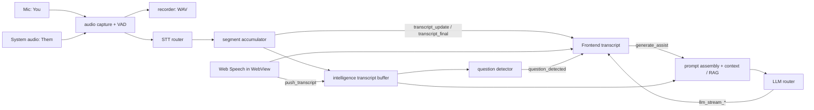

# NexQ Architecture

This document explains how NexQ is put together, for contributors who want to find their way around the code. For setup and day-to-day commands, see [DEVELOPMENT.md](DEVELOPMENT.md).

## Overview

NexQ is a [Tauri 2](https://v2.tauri.app/) desktop app made of two processes:

- **Rust backend** (`src-tauri/src/`, tokio async runtime): audio capture, speech-to-text, LLM streaming, prompt assembly, RAG, translation, SQLite, credentials, tray and updater.
- **React frontend** (`src/`, React 18 + TypeScript + Vite, rendered in WebView2 on Windows and WKWebView on macOS): all UI, state in Zustand stores, Web Speech, and the launcher-side Azure MAI Speech SDK bridge.

They talk over Tauri IPC: the frontend **invokes commands** and the backend **emits events**.

## Windows

Defined in `src-tauri/tauri.conf.json`, both loading the same frontend bundle:

| Label | Size | Purpose |
|---|---|---|
| `launcher` | 900x650 in the config; opens at min(1180x740, 92% of the work area) the first time, then where you left it | Main window: workspaces (list, chat and Library), meeting details, settings, setup |
| `overlay` | 500x700 | In-meeting window: always on top, transparent, the dockable panels (transcript, assistant, notes, brief, talking points and more) |

Both windows remember their size and place (`src/lib/windowPlacement.ts`; never while hidden or minimised, and clamped to a connected monitor). Each window runs its **own JavaScript context with its own store instances**. State that must be shared crosses windows through backend events (for example `meeting_started`, `nexq:meeting_ended`) and through settings persisted by the backend. A detached Dev Log window (`?view=devlog`) can also be opened from the overlay. A system tray (`src-tauri/src/tray/`) controls meetings and windows.

## The meeting pipeline

1. **Audio capture** (`src-tauri/src/audio/`). Two independent parties: the microphone ("You", `mic_capture.rs`) and system output ("Them", `system_capture.rs`, a cpal loopback stream; WASAPI on Windows). Audio is resampled (`resampler.rs`), gated by voice activity detection (`vad.rs`), optionally recorded to WAV (`recorder.rs`) and measured for level meters (`audio_level` events). Each party has its own mute flag in `AppState`; muting stops STT but not recording or levels. Each side runs on its own thread (`capture_supervisor.rs`) that owns its stream and reopens it, on the chosen device or else the default one, when cpal reports the device lost or changed; it reports `audio_capture_status` events (and `audio_capture_stopped` once every side has stopped) and never touches the recorder, STT or the other side.
2. **Speech-to-text** (`src-tauri/src/stt/`). Providers implement the `STTProvider` trait (`provider.rs`) and are selected per party by the router in `stt/mod.rs`. Local engines (Whisper.cpp, Sherpa-ONNX, ORT Streaming, Parakeet TDT) and cloud engines (Deepgram, Groq Whisper, Whisper API, Azure Speech, Cartesia, Windows Speech) live here; model downloads are handled by `stt/local_engines/`. The existing **Azure Speech** provider (`azure_speech`) remains a REST implementation that submits roughly five-second audio batches. **Azure MAI Streaming** (`azure_mai_streaming`) is a separate provider using Microsoft's official Azure Speech SDK for JavaScript and the `mai-transcribe-2-streaming` model. Its SDK runs in NexQ's launcher WebView; Rust retains audio capture and transcript ownership and streams PCM through a bounded IPC bridge. The Speech resource key stays in Rust, with only a short-lived token passed to the SDK. The provider returns live interim updates and Azure final results, but does not provide diarization. **Web Speech** is another frontend exception: it runs in `src/hooks/useSpeechRecognition.ts` and sends results to the backend with the `push_transcript` command.
3. **Segmentation.** `segment_accumulator.rs` merges partial results into paragraphs using the configurable pause threshold, then the backend emits `transcript_update` (interim) and `transcript_final` events and pushes final segments into the intelligence engine.
4. **Intelligence** (`src-tauri/src/intelligence/`). `transcript_buffer.rs` keeps the rolling transcript; `question_detector.rs` emits `question_detected`; `context_scope.rs` resolves which part of the transcript an action uses; `context_builder.rs` and `prompt_templates.rs` assemble the prompt from the transcript, the active scenario (pushed by the frontend with `set_active_scenario`), loaded documents and RAG results. User actions (Assist, What to Say, Recap, Ask, summaries, action items and so on) all go through the `generate_assist` command.
5. **LLM** (`src-tauri/src/llm/`). Providers implement a common streaming trait (`provider.rs`) behind a router (`llm/mod.rs`): OpenAI-compatible endpoints (`openai_compat.rs`, used for OpenAI, Groq, LM Studio and OpenRouter), Anthropic, Gemini (plus `gemini_cache.rs` for Gemini Context Cache), Ollama, and custom endpoints (`custom.rs`, SSE or NDJSON). Tokens stream to the UI as `llm_stream_start`, `llm_stream_token`, `llm_stream_thinking`, `llm_stream_sources`, `llm_stream_end` and `llm_stream_error`, scoped by request id so concurrent requests and cancellation (`cancel_generation`) stay separate.
6. **Claude CLI provider** (`src-tauri/src/llm/cli_agent/`). Uses the user's own Claude subscription by running the local `claude` CLI as a persistent hidden child process speaking the stream-json protocol (`session.rs`, `protocol.rs`), with tools disabled (`command.rs`). `manager.rs` keeps warm per-meeting sessions and sends only transcript deltas; `detect.rs` finds the CLI and checks the login; `routing.rs` decides when to fall back. Status is reported through `agent_session_status` and `agent_fallback` events.

## Supporting subsystems

| Module | Responsibility |
|---|---|
| `rag/` | Local RAG: `chunker.rs`, embeddings through Ollama (`embedder.rs`), SQLite FTS5 keyword search (`fts_store.rs`), cosine-similarity vectors (`vector_store.rs`), hybrid `search.rs`, and live transcript indexing. Progress is reported with `rag_index_progress` and never blocks the UI. |
| `context/` | Loading context documents (PDF with a fallback extractor, DOCX, TXT, MD) and token counting. |
| `translation/` | Translation router: DeepL, Google, Microsoft, LLM-based, and offline OPUS-MT models. |
| `db/` | SQLite via rusqlite (`nexq.db`), with versioned migrations in `migrations.rs`. Tables cover meetings, transcript segments, speakers, bookmarks, action items, topic sections, translations, meeting chat, context resources and RAG chunks/embeddings. |
| `credentials/` | API keys in the OS credential store: Windows Credential Manager (`windows_cred.rs`); macOS Keychain (`macos_keychain.rs`). Keys never go into settings files or the database. |
| `commands/` | One module per feature area exposing `#[command]` functions; all are registered in `lib.rs`. |
| `tray/` | Tray icon, menu and tooltip state. |
| `commands/updater_commands.rs` | Discord-style updater: background download, Ed25519-verified install on quit, never during a meeting. |
| `commands/stealth_commands.rs` | Stealth mode: keeps every NexQ window out of screen capture (`WDA_EXCLUDEFROMCAPTURE` on Windows, `NSWindowSharingNone` on macOS). |

## Workspaces, search, chat and the live helpers

Workspaces group meetings, chats and material (documents, folders, MCP servers, talking points, memory). The pieces below are separate modules. `lib.rs` wires them together, and `AppState` holds the ones that need a slot (for example the chat hub).

| Module | Responsibility |
|---|---|
| `workspace/` | The workspace data layer. `store.rs` has the CRUD (create, clone, archive, delete, default, order, items). `rules.rs` is the one place for the sharing rules (keep separate, include General, who may borrow). `scope.rs` turns them into an `EffectiveScope`: the documents, folders, servers and talking points one meeting or chat may use. Every consumer (prompt assembly, RAG, folders, tools, search, chat) filters by it before ranking. `meetings.rs` holds a meeting's home and borrowed workspaces and moves meetings. `documents.rs` and `library.rs` keep the document text cache and the list of what the library holds. `sources_seed.rs` files folders and servers (which live in the webview's plugin store) into General once, and on explicit adds. `access.rs`, `restart.rs` and `derived.rs` decide what a change takes away, restart sessions (revocations at once, additions coalesced) and delete what was made from material that left. `purge.rs` deletes or moves everything a meeting or workspace owns, recordings included. `runtime.rs` resolves a request's scope from `AppState` and fails closed. `talking_points.rs` and `memory.rs` store the user's notes and approved facts. `types.rs` mirrors `src/lib/types.ts`. |
| `db/workspace_migrations.rs` | Schema steps v9 to v15 (workspaces, search, chat, notes, talking points, brief, memory). All pending steps run in one transaction recorded in `schema_steps`. A failure rolls back, is recorded and shown, and the app runs without workspaces. Before the first run on a database with data, it copies the database to `nexq-before-workspaces.db` (removed after 14 days). |
| `workspace_search/` | The local search index. `passages.rs` cuts transcripts, documents and talking points into passages. `crawler.rs` and `safe_open.rs` read folders (limits on size, file count and names; no links followed; no secret-looking files). `indexer.rs` is a low-priority background service that pauses during meetings and uses its own SQLite connections. `search.rs` ranks with FTS5 BM25, a recency boost for transcripts and a limit per source. `cards.rs` makes a short recap per meeting. `context_plan.rs` is the context ladder that decides what one question sends (instructions, memory, pinned items, meeting recaps, passages, conversation) within a token budget. `cjk.rs` handles Chinese, Japanese and Korean text. There are no embeddings here. |
| `workspace_chat/` | Workspace chat. `engine.rs` builds the context, runs the question through `ai_runs`, streams `workspace_chat_*` events and saves only answered pairs. `hub.rs` holds the request guard, session fingerprints and the indexer. `approval.rs` connects chat sessions to tool approval. `files.rs` writes the private transcript files a CLI chat may read. `scope_adapter.rs` turns an `EffectiveScope` into what search and the ladder take. It is independent of `generate_assist` and of the active provider's lock. |
| `workspace_memory/` | One model call after a meeting proposes up to 8 memory items. Nothing is saved until the user approves it. |
| `ai_runs/` | The one service every chat, notes, brief, recap and memory call goes through. Each run has its own provider instance (`create_provider`) or its own CLI session scope (`SessionScope::Workspace`, `Notes`, `Brief`), a kind, model and effort, a cancel token and usage. Errors are typed and never fall back to another provider. `gate.rs` (`LiveGate`) gives live answers priority without a lock. `windows.rs` finds a model's real context window. |
| `live_common.rs`, `live_notes/`, `live_brief/` | The pure cores of live notes and the brief: the notes document and its protection rules, the operation parser, trigger state machines, the topic-change detector, the sheet validator, prompts and engines. Time, the model call, events and saving are injected, so they run in tests with fakes. |
| `live_runtime/` | The running side: one actor per meeting and feature, fed from the transcript path without blocking it, calling the model through `ai_runs`. Holds the settings of notes, brief and memory suggestions. |
| `live_eval/` | Test-time evals for notes, brief and memory: scripted conversations, fixtures of model outputs, a scorer and a one-hour simulation. Nothing here runs in the app. |
| `prompt_data.rs` | The one way text we don't control (transcripts, documents, notes, memory, titles) goes into a prompt: fenced with a random marker, with look-alike control text neutralised. |
| `llm/cli_agent/approval.rs` | Tool approval for workspace chat. A pure policy decides per call: run, ask or deny. Asking needs Claude 2.1.328 or newer. Codex and Antigravity can't ask, so the tools that would ask are off for them. A question not answered in 60 seconds is denied. |
| `llm/cli_agent/transcripts.rs` | Private, read-only folders of meeting transcripts for CLI chats, under `%LOCALAPPDATA%\NexQ\chat-transcripts`. One per chat session, removed when it closes and at start. |
| `store_guard.rs` | Checks the settings files (`config.json`, `nexq-settings.json`, `translation-config.json`) before the store plugin loads them. A damaged file is kept aside and the last good `.bak` copy is put back. Good copies are refreshed at start and every 10 minutes. |
| `app_paths.rs` | Where NexQ keeps its files, from one place, derived from the app identifier so a test build never touches the real app's folders. |
| `commands/workspace_commands.rs`, `workspace_chat_commands.rs`, `live_commands.rs` | The IPC for the modules above. A change that takes material away goes through `change_and_restart`, which restarts the sessions that used it. |

### Meeting window docking

The meeting window is a dock (`src/overlay/dock/`). The layout is a tree of splits and tab stacks. A pure reducer (`layoutReducer.ts`) keeps its invariants: every panel exists once, docked or hidden, there are no empty nodes, and sizes stay above their minimum. `layoutGeometry.ts` turns the tree and the window size into rectangles. When a split doesn't fit along its axis it wraps, and when that doesn't fit either it merges into tabs. Panels live in one flat layer and are moved, never re-mounted, so state survives a layout change. Drag and drop uses pointer events only.

### AppState

`src-tauri/src/state.rs` defines `AppState`, managed by Tauri and injected into commands as `State<'_, AppState>`. It holds one slot per subsystem (`database`, `audio`, `stt`, `llm`, `intelligence`, `context`, `credentials`, `rag`, `translation`, models and more), mostly as `Arc<Mutex<...>>`, plus lock-free atomics for hot paths such as per-party mute flags and the pause threshold. Managers are created during setup in `lib.rs`; most initialization failures are logged and leave the slot empty rather than crashing the app.

## Frontend

| Path | Contents |
|---|---|
| `src/lib/types.ts` | Every TypeScript type. **Must mirror the Rust structs**: a mismatch silently breaks serialization. |
| `src/lib/ipc.ts` | Typed wrapper for every Tauri command. Components never call `invoke()` directly. |
| `src/lib/events.ts` | Typed listeners for every backend event. |
| `src/stores/` | Zustand stores, one per domain: config, meeting, transcript, stream, call log, context, RAG, speakers, bookmarks, action items, translation, updater and others. |
| `src/hooks/` | `useXxx` hooks that own side effects and event subscriptions (transcript, speech recognition, STT status, updater, shortcuts, persistence). |
| `src/launcher/`, `src/overlay/`, `src/settings/`, `src/calllog/`, `src/context/` | Feature UIs. |
| `src/workspace/` | The launcher's home: workspace list, Library, chat (`chat/`), dialogs and the scope helpers. |
| `src/talking-points/` | The note editor (TipTap), the prompter, and the local voice-following and "said it" logic (`follow/`). |
| `src/overlay/dock/` | The dockable meeting window. |
| `src/live-notes/`, `src/live-brief/`, `src/memory/` | Panels and stores for live notes, the brief and workspace memory. |
| `src/models/`, `src/voiceprint/` | The shared model picker, and the waveform marks and context graph. |
| `src/components/` | shadcn/ui primitives and shared components (status bar, toasts, audio player). |
| `src/demo/` | Demo mode with scripted scenarios for screenshots and onboarding. |

Styling is Tailwind CSS with shadcn/ui and CSS custom properties for theming.

## Persistence at a glance

| What | Where |
|---|---|
| Meetings, transcripts, AI history, RAG index | `nexq.db` in the app data directory |
| Downloaded STT and translation models | `models/` in the app data directory |
| Recordings | `recordings/` in the app data directory |
| Settings and preferences | `nexq-settings.json`, `config.json` and `translation-config.json` (Tauri store plugin), each with a `.bak` copy |
| Workspaces, chats, notes, brief, talking points, memory, search index | `nexq.db` |
| Copy of the database from before the workspaces upgrade | `nexq-before-workspaces.db`, removed after 14 days |
| API keys | OS credential store |

The app data directory is `%APPDATA%\com.nexq.app` on Windows and `~/Library/Application Support/com.nexq.app` on macOS.

## Adding things

- **A new command:** see [CONTRIBUTING.md](../CONTRIBUTING.md#adding-a-tauri-command).
- **A new STT provider:** add a variant to `STTProviderType` in `stt/provider.rs` (and its string id), implement `STTProvider`, wire it in the router in `stt/mod.rs`, mirror the type in `src/lib/types.ts`, and add it to the STT settings UI.
- **A new LLM provider:** add a variant in `llm/mod.rs`, implement the provider trait from `llm/provider.rs` (or reuse `openai_compat.rs` if the API is OpenAI-compatible), mirror the type in `types.ts`, and add settings UI.
