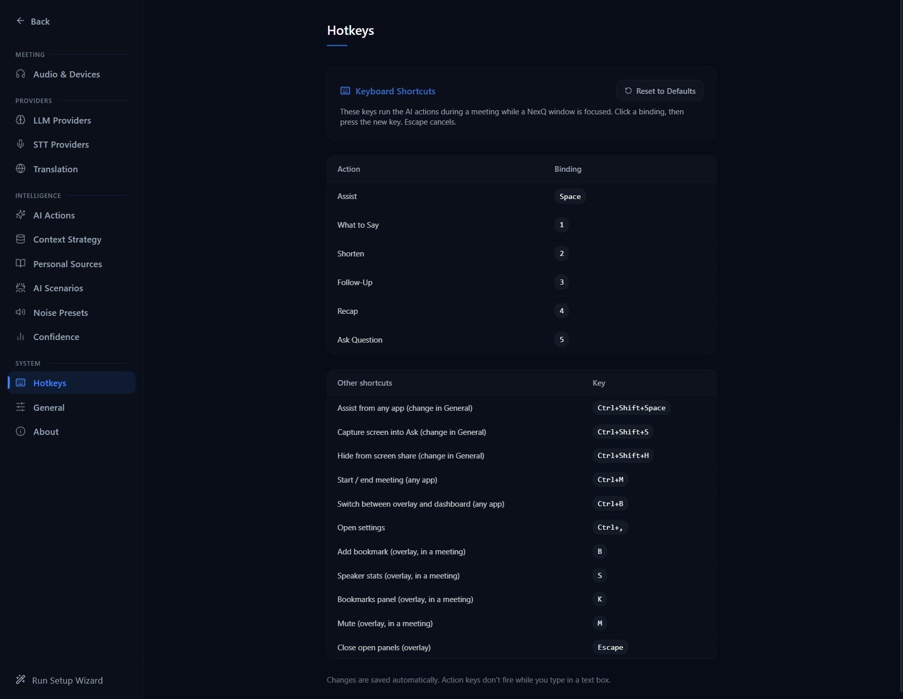

# Configuration Guide

NexQ supports multiple STT and LLM providers, configurable audio devices, and local RAG for document context. All settings are accessible via **Settings** (`Ctrl+,`).

## General Settings

The General settings panel controls app-wide behavior and preferences. Here you can configure:

- **App behavior** -- startup options, system tray behavior, and window preferences
- **Theme and appearance** -- light/dark mode and visual customization. A theme change reaches the open meeting window at once. The default transcript and answer text colours follow the theme, so they stay readable in the light theme; a colour you picked yourself is used as chosen
- **Language** -- interface language selection
- **Update preferences** -- NexQ downloads updates quietly in the background and shows an "Update ready" button in the footer. Click it to see what's new and install when convenient, or it installs when you quit (never during a meeting). You always get the newest version, even if several came out since your last update. Turn this off under Settings > About > Automatic updates
- **Data management** -- storage location and cleanup options

## Speech-to-Text (STT) Providers

NexQ uses a two-party audio model: **"You"** (microphone) and **"Them"** (system audio) each have independent STT providers, devices, and mute controls. See the [AI Providers Guide](ai-providers.md) for a detailed comparison of all STT providers and help choosing the right one.

### Web Speech API (Built-in)

- **Setup**: None -- works out of the box
- **Requires API Key**: No
- **Runs Locally**: No (your mic audio goes to the browser's cloud speech service)
- **Best For**: Quick start, low resource usage
- **Limitations**: Requires an active internet connection on some systems; accuracy varies by browser engine

### Deepgram

- **Setup**: Create an account at [deepgram.com](https://deepgram.com) and generate an API key
- **Requires API Key**: Yes
- **Runs Locally**: No (cloud)
- **Best For**: High-accuracy real-time transcription
- **Models**: nova-3 (recommended), nova-2, nova, enhanced, base; Flux and Flux Multilingual for Auto-Answer
- **Flux**: tells NexQ when a speaker has finished, so Auto-Answer replies at once. It doesn't tell speakers apart. Quiet time counts toward Deepgram usage; muted time doesn't, since muting closes the stream
- **Configuration Options** (Flux uses only numerals, the profanity filter and key terms):
  - Smart formatting, punctuation, numerals
  - Endpointing threshold (silence detection)
  - Diarization, profanity filter
  - Custom key terms

### Groq Whisper

- **Setup**: Create an account at [groq.com](https://groq.com) and generate an API key
- **Requires API Key**: Yes
- **Runs Locally**: No (cloud)
- **Best For**: Fast Whisper inference at low cost
- **Models**: whisper-large-v3, whisper-large-v3-turbo
- **Configuration Options**:
  - Language (auto-detect or specify ISO 639-1 code)
  - Temperature (0.0--1.0)
  - Batch segment duration
  - Response format, timestamp granularity

### Cartesia

- **Setup**: Create an account at [cartesia.ai](https://cartesia.ai) and create an API key at [play.cartesia.ai/keys](https://play.cartesia.ai/keys)
- **Requires API Key**: Yes
- **Runs Locally**: No (cloud)
- **Best For**: Real-time transcription where each line ends when the speaker finishes a thought
- **Model**: ink-2. Cartesia decides where each turn ends and detects the language on its own, so there is nothing to configure
- **Languages**: English, French, Hindi, Japanese, Spanish. Settings warns when the selected language isn't one of them
- **Cost**: Billed per second of audio while a channel is unmuted, silence included (about 3 credits per second for each channel that uses Cartesia). Muted time isn't billed: muting closes the stream

### Azure MAI Streaming (public preview)

- **Provider ID**: `azure_mai_streaming` (a separate provider from `azure_speech`)
- **Model**: `mai-transcribe-2-streaming`
- **SDK**: Official Microsoft Azure Speech SDK for JavaScript, bundled with NexQ; no separate runtime or SDK installation is needed
- **Setup**: Use a Speech resource key and its matching region. The model is available in `swedencentral`, `centralus`, `eastus2`, and `southeastasia`
- **Live results**: Interim transcript updates while speaking, followed by Azure final results
- **Languages**: Multilingual auto-detection by default, or choose a supported explicit locale per side
- **Diarization**: Not supported. NexQ keeps "You" and "Them" on separate audio channels, but Azure does not label multiple speakers within one channel
- **Existing Azure Speech**: Remains a separate REST-based provider that submits short audio batches; it is not this streaming model

See [Choosing AI Providers](ai-providers.md#azure-mai-streaming-public-preview) for portal setup, the exact setup steps, and a live verification checklist.

### Local engines (Sherpa-ONNX, ORT Streaming, Parakeet TDT)

- **Setup**: Download a model from Settings > STT Providers (each local engine has its own model list)
- **Requires API Key**: No
- **Runs Locally**: Yes
- **Best For**: Offline use, privacy-sensitive environments
- **Live engines**: Sherpa-ONNX, ORT Streaming and Parakeet TDT. These are the local choices for "You" and "Them" in Settings > Audio & Devices
- **Whisper.cpp**: Not a live engine. It only transcribes recorded meetings in batch, so Settings > Audio & Devices doesn't offer it for a live meeting. A saved setup that still names it is switched to another engine at the next launch
- **Note**: Local models require significant CPU/RAM. Smaller models are faster but less accurate; larger ones are more accurate but slower.

### Windows Native Speech

- **Setup**: Turn on "Online speech recognition" in Windows Settings > Privacy & security > Speech
- **Requires API Key**: No
- **Runs Locally**: No (dictation uses Microsoft's online speech service)
- **Best For**: No-key fallback for your mic on Windows

## LLM Providers

The LLM provider powers all AI features: Assist, What to Say, Shorten, Follow-Up, Recap, Ask Question, Meeting Summary, and Action Items. See the [AI Providers Guide](ai-providers.md) for a detailed comparison of all LLM providers, including local vs cloud tradeoffs and setup instructions.

### Ollama (Local)

- **Setup**:
  1. Download and install from [ollama.ai](https://ollama.ai)
  2. Pull a model: `ollama pull llama3.2` (or `mistral`, `gemma2`, etc.)
  3. NexQ auto-detects Ollama on startup at `http://localhost:11434`
- **Requires API Key**: No
- **Runs Locally**: Yes
- **Best For**: Privacy, no usage costs, offline capability

### OpenAI

- **Setup**: Get an API key from [platform.openai.com](https://platform.openai.com)
- **Requires API Key**: Yes
- **Runs Locally**: No
- **Models**: GPT-4o, GPT-4o-mini, GPT-4-turbo, GPT-3.5-turbo, and more

### Anthropic

- **Setup**: Get an API key from [console.anthropic.com](https://console.anthropic.com)
- **Requires API Key**: Yes
- **Runs Locally**: No
- **Models**: Claude 4 Opus, Claude 4 Sonnet, Claude 3.5 Haiku, and more

### Groq

- **Setup**: Get an API key from [console.groq.com](https://console.groq.com)
- **Requires API Key**: Yes
- **Runs Locally**: No
- **Best For**: Ultra-fast inference
- **Models**: Llama 3, Mixtral, Gemma, and more

### Google Gemini

- **Setup**: Get an API key from [aistudio.google.com](https://aistudio.google.com)
- **Requires API Key**: Yes
- **Runs Locally**: No
- **Models**: Gemini 2.0 Flash, Gemini 1.5 Pro, Gemini 1.5 Flash

### LM Studio (Local)

- **Setup**:
  1. Download from [lmstudio.ai](https://lmstudio.ai)
  2. Download a model and start the local server
  3. NexQ connects to LM Studio's OpenAI-compatible API
- **Requires API Key**: No
- **Runs Locally**: Yes

### OpenRouter

- **Setup**: Get an API key from [openrouter.ai](https://openrouter.ai)
- **Requires API Key**: Yes
- **Runs Locally**: No
- **Best For**: Access to hundreds of models from multiple providers through a single API
- **Features**: Model catalog with pricing, context length, and capability info

## API Key Management

All API keys are stored securely in **Windows Credential Manager** (not in config files or plain text). NexQ uses the Windows `CredentialManager` API to:

- Store keys: `Settings > [Provider] > API Key > Save`
- Test keys: `Settings > [Provider] > Test Connection`
- Delete keys: `Settings > [Provider] > Remove API Key`

Keys are scoped to your Windows user account and persist across app updates.

## Audio Device Configuration

See the [Audio Setup Guide](audio-setup.md) for a comprehensive guide to audio configuration, including device selection, WASAPI loopback details, and troubleshooting common audio issues.

### Microphone ("You")

Select the input device used for capturing your voice. The device picker shows all available input devices with a live audio level meter for verification.

### System Audio ("Them")

Select the output device used to capture remote participants' audio via Windows loopback (WASAPI). This captures whatever audio is playing through that device -- perfect for Zoom, Teams, Google Meet, or any conferencing app.

### Audio Testing

Use the **Test** button next to each device to verify audio levels before starting a meeting. The live peak meter shows real-time audio levels from the selected device.

### Recording

Enable **Recording** to save meeting audio as WAV files alongside the transcript. Recordings are stored in the app data directory and can be played back from the meeting history.

## Context Intelligence (RAG)

NexQ supports loading documents (PDF, TXT, MD, DOCX) as context for AI responses. When RAG is enabled, the AI uses relevant document chunks to provide more informed answers. See [Using Context Intelligence (RAG)](rag-context.md) for a complete guide to loading documents, best practices by use case, and optimization tips.

### Setup

1. Open Settings > Context Strategy and choose **Local RAG**
2. Configure the embedding model (requires Ollama with an embedding model like `nomic-embed-text`)
3. Add documents in the **Library** of a [workspace](workspaces.md): **Choose files**, or drop them on the window
4. Documents are automatically chunked, embedded, and indexed

### Configuration

- **Chunk size and overlap**: Control how documents are split
- **Top-K results**: Number of relevant chunks included in AI context
- **Similarity threshold**: Minimum relevance score for chunk inclusion
- **Search mode**: Semantic, keyword (FTS), or hybrid search

## Workspaces

Meetings, chats and files are kept in [workspaces](workspaces.md). Most workspace options are on the workspace itself: open it and use **Edit workspace** (name, colour, instructions for the AI, the scenario it starts as, **Also use General**, **Keep separate**, **Make default** and **Prepare recaps with AI**) and the **Library** (documents, folders, tools, talking points and memory). Settings keeps the global parts:

- **Settings > Personal Sources**: the list of notes folders and tools, their on and off switches, tool permissions and secret values
- **Settings > Context Strategy**: how documents reach live answers ([Using Context Intelligence](rag-context.md))
- **Settings > Live Notes and Brief**: the model, detail and limit of the [live notes and brief](live-notes-and-brief.md)

[Workspace chat](workspace-chat.md) has its own model per chat, picked in the chat itself. By default it uses the provider and model you set under **LLM Providers**.

## AI Actions

The AI Actions panel configures how NexQ's AI assistance behaves during meetings. Key options include:

- **Action types** -- enable or disable specific AI modes (Assist, What to Say, Shorten, Follow-Up, Recap, Ask Question)
- **Question Detection** -- show questions from the other party as cards in the overlay; click a card to get an answer to that question
- **Auto-Answer** -- off by default. Turn it on to answer the newest detected question automatically, instead of clicking the card you need. With Cartesia or Deepgram Flux, the answer starts as soon as the speaker finishes, or earlier when they have probably finished; if they keep talking, that early answer is dropped and the full question is answered. Other engines wait for 1.5 seconds of quiet, since they can end a line mid-sentence. Asking for something yourself during an automatic answer (`Space`, a number key, a button or a question card) stops it and runs what you asked for; an automatic answer never interrupts yours
- **Response style** -- adjust the tone, length, and format of AI responses
- **Context window** -- control how much conversation history is sent to the LLM with each request

## AI Scenarios

AI Scenarios let you switch between pre-configured prompt profiles optimized for different use cases. Each scenario tunes the AI's behavior, tone, and focus:

- **Interview** -- focuses on answer framing, follow-up suggestions, and conversational guidance tailored to job interviews
- **Lecture** -- emphasizes summarization, key concept extraction, and study-relevant assistance
- **Meeting** -- provides general meeting assistance with action items, decisions tracking, and discussion summaries
- **Custom** -- create your own scenario with custom system prompts and behavior settings

Select a scenario in Settings before starting a meeting to get the most relevant AI assistance.

## Confidence Display

The Confidence settings control how NexQ displays transcription confidence indicators. Configure:

- **Confidence threshold** -- set the minimum confidence level for displaying transcribed text
- **Visual indicators** -- toggle color-coded confidence highlighting on transcript segments
- **Low-confidence handling** -- choose how to display uncertain transcriptions (dim, strikethrough, or hide)

Higher confidence thresholds filter out uncertain transcriptions, giving you a cleaner transcript at the cost of potentially missing some words.

## Hotkeys

Settings > Hotkeys lists the in-meeting keys and the other shortcuts NexQ uses.

- **Rebindable here** -- Assist (`Space`) and the five action keys: What to Say (`1`), Shorten (`2`), Follow-Up (`3`), Recap (`4`) and Ask Question (`5`). Click a binding and press the new key. Reset to Defaults brings the originals back
- **Fixed** -- `Ctrl+M` (start or end a meeting), `Ctrl+B` (overlay or dashboard), `Ctrl+,` (Settings), and in the overlay `Escape`, `B`, `S`, `K`, `M` and `N` (update the live notes). These are listed in the editor but can't be changed
- **Changed in General** -- Assist from any app, Capture screen into Ask and Hide from screen share. Their keys are set in Settings > General and shown in Hotkeys for reference

See [Keyboard Shortcuts](keyboard-shortcuts.md) for the full reference and what each key does.

## Noise Preset

Noise Preset settings help optimize audio quality for transcription accuracy. Configure:

- **Noise reduction level** -- adjust the aggressiveness of background noise suppression
- **Environment presets** -- select from pre-configured profiles for common environments (quiet room, office, cafe, outdoors)
- **Voice activity detection (VAD)** -- tune sensitivity for detecting when someone is speaking vs. silence
- **Audio enhancement** -- enable or disable audio processing filters that improve STT accuracy

Choose the preset that matches your typical meeting environment for the best transcription results.

## Translation

The Translation settings configure real-time translation of meeting transcripts. Key options include:

- **Target language** -- select the language you want transcripts translated into
- **Source language** -- set the expected language of speakers, or use auto-detect
- **Translation provider** -- choose the translation engine (uses the configured LLM provider)
- **Display mode** -- show translations inline alongside the original text, or replace the original text entirely

Translation works in real-time during meetings, providing translated text alongside or in place of the original transcription.
