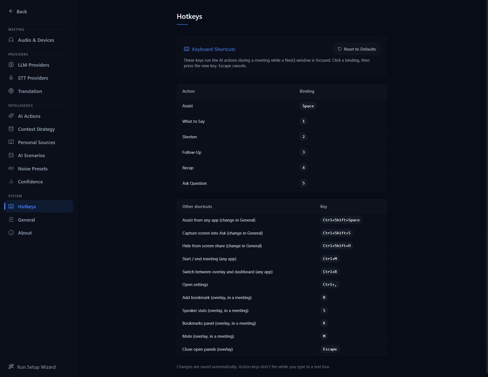

# Keyboard Shortcuts

NexQ has two levels of keyboard shortcuts: **global shortcuts** that work even when the app is not focused, and **meeting shortcuts** that work during an active meeting when the NexQ window is focused.

## Hotkey Configuration

Settings > Hotkeys lets you change the meeting keys below (Assist and the five actions). Click a binding and press the new key; Reset to Defaults brings back `Space` and `1` to `5`. The three Ctrl+Shift shortcuts in the Global table are changed in Settings > General, and Ctrl+M, Ctrl+B and Ctrl+, are fixed.

## Global Shortcuts

These shortcuts are registered system-wide and work regardless of which application has focus.

| Shortcut | Action | Description |
|----------|--------|-------------|
| `Ctrl+M` | Start / End Meeting | Starts a new meeting if none is active; ends the current meeting if one is running |
| `Ctrl+B` | Switch between overlay and dashboard | Switches between the launcher (dashboard) and the overlay (meeting) window. With no meeting running, it brings the dashboard back. In a NexQ text editor, such as the talking points editor, it makes the selection bold instead |
| `Ctrl+,` | Open / Close Settings | Toggles the settings panel |
| `Ctrl+Shift+H` | Hide from screen share | Turns stealth mode on or off. Change it in Settings > General |
| `Ctrl+Shift+Space` | Assist from any app | During a meeting, generates AI Assist without switching to NexQ. Stops an automatic answer that's running. Change it in Settings > General |
| `Ctrl+Shift+S` | Capture screen into Ask | During a meeting with Claude (subscription), attaches a picture of the screen your mouse is on to the Ask box, opens it and puts the cursor there; press Enter to send. Windows only for now. Not used with other providers, so the key stays free for your other apps. Change it in Settings > General |

## Meeting Shortcuts

These shortcuts work when a meeting is active and the NexQ window (launcher or overlay) is focused. They do not trigger when typing in input fields, text areas, or dropdowns.

| Shortcut | Action | AI Mode |
|----------|--------|---------|
| `Space` | Generate AI Assist | Assist -- analyzes conversation and provides contextual help. Stops an automatic answer that's running |
| `1` | What to Say | Suggests what you should say next based on the conversation |
| `2` | Shorten | Condenses the recent discussion into a brief summary |
| `3` | Follow-Up | Generates follow-up questions or discussion points |
| `4` | Recap | Provides a recap of the conversation so far |
| `5` | Ask Question | Opens the free-form question input for custom AI queries |

These overlay keys are fixed (they can't be rebound in Settings > Hotkeys) and need a running meeting. They work only as bare keys (no Ctrl, Alt, Meta or Shift held). Only `Escape` also works while typing in an input.

| Shortcut | Action |
|----------|--------|
| `B` | Add a bookmark at the current point in the meeting |
| `S` | Open or close the speaker stats panel |
| `K` | Open or close the bookmarks panel |
| `M` | Mute or unmute your microphone ("You") |
| `N` | Update the live notes now (when live notes are on and not already updating) |
| `Escape` | Put away the panels you opened on the fly (speaker stats, bookmarks, AI Call Log, developer log) |

`Ctrl+Shift+L` shows or hides the Dev Log panel.

> In the Ask box, `Ctrl+V` attaches a copied screenshot (Claude subscription only). `Ctrl+Shift+S` captures the screen for you; see [Asking about something on screen](claude-subscription.md#asking-about-something-on-screen). Screenshots can include other people's video or documents and go to Anthropic with your question; NexQ doesn't save them.

> **Note:** The number keys (`1`--`5`) work with both the main keyboard and the numpad. They only trigger when no modifier keys (Ctrl, Alt, Meta, Shift) are held, and the same goes for the other action keys.

## Workspaces

These work in the launcher (`Cmd` replaces `Ctrl` on macOS).

| Shortcut | Action |
|----------|--------|
| `Ctrl+Shift+O` | Switch workspace: type part of a name, `Up` and `Down` to move, `Enter` to open |
| `Ctrl+Shift+N` | Create a new workspace |
| `Ctrl+Shift+Y` | Show or hide the Library, when the window is too narrow to show it beside the chat |

In the [workspace chat](workspace-chat.md), `Enter` sends the question and `Shift+Enter` adds a line.

### Moving around the dashboard

Each list is one Tab stop, so you do not tab through every meeting or file to get past it. Tab lands on the row you used last.

| Shortcut | Action |
|----------|--------|
| `Up` and `Down` | Previous or next row in the workspace list, the meeting list or the Library |
| `Home` and `End` | First or last row |
| `Enter` | Open the row |
| `Right`, `Menu` key or `Shift+F10` | Move to the row's own actions (star, rename, move, delete, menu); `Right` again goes to the next one |
| `Left` or `Escape` | Back to the row |
| `F6` and `Shift+F6` | Next or previous area: workspaces and meetings, chat, Library, status bar |
| `Tab` from the top of the page | Skip links: to workspaces and meetings, to chat, to the Library |

## Meeting Window Panels

With a panel tab focused (see [Meeting window layout](meeting-layout.md)):

| Shortcut | Action |
|----------|--------|
| `Left` and `Right` | Previous or next tab |
| `Home` and `End` | First or last tab |
| `Alt+Shift+Left` and `Alt+Shift+Right` | Move the tab one place in its row |
| `Menu` key, `Shift+F10` or `Alt+Down` | Open the Move menu for the panel |
| `Escape` | Cancel a drag in progress |

With a separator between panels focused:

| Shortcut | Action |
|----------|--------|
| Arrow keys | Resize by 16 pixels |
| `Shift` and arrow keys | Resize by 64 pixels |
| `Home` and `End` | Smallest and largest size |
| `Enter` | Even out the two panels |

## Talking Points Panel

With the note focused in the Talking points panel ([Talking points](talking-points.md)):

| Shortcut | Action |
|----------|--------|
| `Space` | Play or pause auto-scroll (it doesn't start an AI answer here) |
| `Enter` | Tick the current line, or go to the suggested point |
| `Backspace` | Go back to where you were after a big jump |
| `+` and `-` | Bigger or smaller text |
| Arrow, `Page Up`, `Page Down`, `Home`, `End` | Scroll yourself |

In the editor: `Ctrl+B`, `Ctrl+I` and `Ctrl+U` for bold, italic and underline, `Ctrl+Alt+1` to `3` for headings, `Ctrl+Shift+8` and `Ctrl+Shift+7` for bullet and numbered lists.

## System Tray

NexQ lives in the Windows system tray. Interaction patterns:

| Action | Result |
|--------|--------|
| Click tray icon | Bring NexQ back: the meeting overlay during a meeting, otherwise the dashboard |
| Middle-click tray icon | Toggle microphone mute |
| Right-click tray icon | Open the context menu: Open Dashboard (and Show Overlay during a meeting) first, then start/stop meeting, quick copy, settings and quit |

With **Hide from screen share** on, NexQ has no taskbar button, so the tray icon and `Ctrl+B` are the way back to it. On macOS, clicking the menu-bar icon opens the menu.

## Tips

- **Overlay during meetings**: Use `Ctrl+B` to bring up the always-on-top overlay while your meeting app (Zoom, Teams, etc.) is in the foreground. The overlay is transparent and stays above other windows.
- **Quick AI assist**: During a meeting, press `Ctrl+Shift+Space` from any app (your meeting app included) to get an instant AI answer without switching to NexQ, which matters when you're sharing your screen. `Space` does the same while the NexQ window is focused.
- **Mute sources independently**: You can mute "You" (mic) or "Them" (system audio) STT independently from the overlay controls. This pauses transcription for that source without stopping audio capture or recording.
